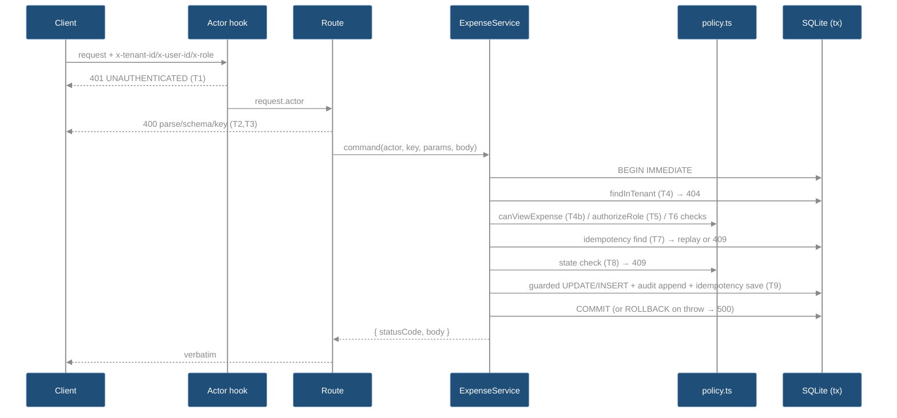

# EXP-003 Tech Specs (WHAT)

Status: **Phase 6 APPROVED** (2026-10-14, author directly in this session: "Yes, I reviewed the plan and specs. Keep BASELINE-API.md unchanged, use separate compatibility notes, and preserve HTTP 400/413/415. Proceed with the original implementation plan and stop at Phase10 for my review."). Phases7–13 are now complete with187 tests passing; see HANDOFF.md and COORDINATOR-CLOSEOUT.md. Changelog entries below describe their historical planning checkpoints, not current pending approvals. Design of record: `plans/EXP-003/architecture-notes.md` → `## Design Review Revision 2` + `### Evaluator consistency reconciliation` (approved at Phase 3, controlling). Draft v1 / Revision 1 = history only. Companion HOW: `plans/EXP-003/EXP-003-PLAN.md`. Specs own target state; plan owns steps. Section IDs `S<n>` are stable cross-reference anchors.

Current follow-up (2026-10-15): the approved AC-011 correction and S4/S5.12/S13 clarification
are implemented. Phase10 approval is recorded; independent test review and final validation
are complete, with204 tests/typecheck/build passing. Publication is pending. The187-test
status above describes the original published checkpoint. See AC-011-FOLLOWUP-REPORT.md.

## Changelog (post Phase-5 review, 2026-10-13)

No tier order or human policy decision changed. Entries describe proposed contracts and future
verification, not completed implementation or passing feature tests. Final reconciliation is dated below.

- **M1** S12.1: a second fault point `test_fail_idem` on `idempotency_records` proves that an already-inserted audit row is rolled back. The `test_fail_audit` case is kept.
- **m5** S12.1: fault injection now covers all 4 mutations (create, decide, delete, restore) × both fault points.
- **M2** S4 T2, S5.7, S5.12, S7.4 #8, S8, S13: body-parser errors keep their native status. Malformed/empty JSON and a Content-Length mismatch ⇒ 400 `VALIDATION_ERROR`. Oversize ⇒ 413 `PAYLOAD_TOO_LARGE` (new). Unsupported media type ⇒ 415 `UNSUPPORTED_MEDIA_TYPE` (new). The 413/415 change from the seed's 500 is documented in break #8. Empty JSON body on DELETE/restore is documented in S7.2 and S13.
- **m1** S5.7: the T2 message comes from a dedicated `bodyParserErrorResult()` helper with the constant `BODY_PARSE_ERROR_MESSAGE`. `errorBody` stays catalog-only.
- **m2** S5.5, S5.7: `ServiceResult` moved to `errors.ts`, which removes the import cycle.
- **m3** S5.9, S6.1: guarded `MIGRATIONS[v]` access (`noUncheckedIndexedAccess`), `user_version` re-read inside each step's transaction, and the DB handle closed before rethrowing from `openDatabase`.
- **m6** S12.3 note: cross-tenant restore and cross-tenant decision with a stored key are required (named in PLAN P7.4).
- **m7** S2 NFR-3, S13: "no echo" means header values, idempotency keys and body values. Body key names in Zod strict-mode messages are allowed.
- **m8** S12.3 #6: renamed. Both `T0+30d` and `T0+30d+1ms` are asserted in integration.
- **m9** S1: this table is canonical. PLAN mirrors it row for row.
- **m10** S7.4 #3: a body id outside the header charset can never match the actor, so it is always 403 `ACTOR_MISMATCH`.
- **m11** S13: same-tenant existence disclosure (404 on GET vs 403 on DELETE/restore) is recorded as an accepted limitation.
- **m12** S5.4, S11: a compile-time non-Promise constraint on `work` is mandatory; the formal type-level test is planned for P7.0. The remaining risk is documented.
- **m13, m14**: PLAN P6.4 and P8's two documentation passes.
- **OI-1** S7.4, S15: zero edits to `docs/BASELINE-API.md` by default. Breaks live in the new `docs/EXP-003-COMPATIBILITY.md`.
- **OI-2** S5.1 (`deletedBy` rationale), S6.1/S6.2 (quarantine DEFAULT reworded as fail-silent, plus the `expenses_no_quarantine_insert` hardening trigger), S7.3 (`updated_at` bump side effect). Item 7 is superseded by M2.

### Changelog addendum (evaluator-plan-review.md reconciliation, 2026-10-13)

Advisory-only (AI evaluator review of the Phase-5 report), not a new human decision and not an approval of any kind; see `plans/EXP-003/evaluator-plan-review.md`. No tier, human decision or Revision 2 rule changed. Findings below are **planned** changes to a Phase-4 draft awaiting Phase 6 HITL — nothing here has been implemented, and no test in this section has been written or run yet.

- **Item 5** S5.3 (`restoreStateCheck`, `isRestoreWindowOpen`), S5.8 (`restore` SQL): the restore window is now an explicit nonnegative bound — negative elapsed time (now precedes deletedAt) throws instead of silently counting as "open", matching human decision 3's literal `[0, 30d)` domain. `restoreStateCheck` adds an explicit `status !== "SUBMITTED"` clause (stable `EXPENSE_NOT_DELETED` denial) and the repository `restore()` SQL adds a matching `status = 'SUBMITTED'` predicate, so restoration checks this precondition at both tiers rather than only assuming every tombstoned row is SUBMITTED.
- **Item 6** S5.4/S11 (m12): the compile-time `NotPromise<T>` constraint on `withTransaction`'s `work` stays mandatory, with no fallback weakening to a plain `work: () => T`. The documented residual risk (an un-awaited async task inside a sync `work`) stands as written.
- **Item 7** terminology, confirmed and clarified — three distinct concepts, never conflated anywhere in SPECS/PLAN/ledger:
  1. **Semantic business authorization** — `policy.ts` decisions (role capability, self-decision, approval limit, ownership, state preconditions) that the running application enforces at request time.
  2. **Rosetta coding-flow review/HITL gates** — the human author's explicit phase approvals (e.g. "Yes, I reviewed the design") and AI reviewer/evaluator findings, which govern whether this workflow may advance to the next phase.
  3. **Host tool permissions** — the operating environment's grant or denial of a tool call (file access, command execution), which is orthogonal to both of the above and never implies either one.
  Also confirmed already satisfied without further edits: S5.7 (`bodyParserErrorResult`/`errorBody` are implementable exactly from the stated contracts, m1); S2 NFR-3 and S12.2 (no-echo scoped to header/key/body values, not key names, m7).
- **Items 2–4, 8–9** are PLAN-level (phase sequencing, HANDOFF.md, approval-status/documentation currency, proposed-vs-decided author choices) — see `EXP-003-PLAN.md` changelog and Open Items.

## S0 TLDR

Evaluator reconciliation, 2026-10-14: corrected stale body text after retaining the actor checkpoint;
removed unconstrained type fallback and premature proof wording, mirrored traceability, clarified
Phase7/11 boundaries, added post-three-write rollback coverage and README updates. Human plan
approval and feature validation remain pending. Original Phase5 findings are preserved separately.

- Option A (approved): actor `onRequest` hook → thin routes → `ExpenseService` (one sync `withTransaction` per mutation) → pure `policy.ts` → tenant-scoped repositories → `node:sqlite`.
- Fixed 9-tier error priority (S4); tier 4 = tombstone-blind tenant existence, 4b = ordinary visibility (GET/:id, list, decision only); delete/restore are tombstone-aware.
- Schema v2 via `PRAGMA user_version` (S6): `expenses` + `tenant_id`/`deleted_at`/`deleted_by`; append-only `audit_events` (triggers); `idempotency_records`. Legacy rows quarantined under `legacy:seed`.
- Idempotency: scope `(tenant, user, key)`; SHA-256 of canonical JSON (S10); only 2xx stored; replay = frozen snapshot.
- Human policy (fixed): employee-only create/delete/restore; legacy quarantine; restore window half-open `[0, 30d)`. Evaluator feedback (fixed): malformed JSON → 400.
- No new dependencies. Not production auth. Not legal retention guidance. Attachments unsupported.

## S1 AC Traceability

Canonical table (m9). The PLAN "AC Traceability" table mirrors these SPECS and PLAN columns exactly. Change both together.

| AC | Text (source: `plans/EXP-003/REQUEST.md`) | SPECS | PLAN |
|---|---|---|---|
| EXP3-AC-001 | Every expense query/mutation tenant-scoped; cross-tenant probes 404/no changes | S4 T4, S5.8, S5.9, S6.2 | P1.2, P3.1, P4.1, P7.4 |
| EXP3-AC-002 | Employee/manager/finance permissions match fixed actor/decision policies | S4 T1/T4b/T5/T6, S5.2, S5.3 | P2.3, P4.1, P5.1, P7.2, P7.4 |
| EXP3-AC-003 | Self-approval and manager approval > 100,000 cents rejected, no state/audit change | S4 T6, S5.3, S5.5, S8 | P2.3, P4.1, P7.2, P7.4 |
| EXP3-AC-004 | Every successful mutation + exactly one audit event, atomic | S4 T9, S5.4, S5.5, S9, S11, S12.1 | P0.2, P1.1, P4.1, P7.5 |
| EXP3-AC-005 | Audit has no app update/delete path; survives logical deletion | S5.10, S6.2, S9 | P1.2, P3.2, P7.5 |
| EXP3-AC-006 | Idempotency replays identical / rejects conflicts, no cross-tenant leak | S4 T7, S5.5, S5.11, S10 | P3.3, P4.1, P7.2, P7.6 |
| EXP3-AC-007 | Only owner tombstones a SUBMITTED expense; reads/lists hide it | S4 T4b/T6/T8, S5.3, S5.8 | P3.1, P4.1, P7.6 |
| EXP3-AC-008 | Decided expenses not employee-deletable; stable retention-policy 409 | S4 T8, S8 (`EXPENSE_RETENTION_LOCKED`) | P4.1, P7.6 |
| EXP3-AC-009 | Owner restore within 30 days, one audit event, idempotent replay | S4 T7/T8/T9, S5.3, S5.5, S9 | P4.1, P7.6 |
| EXP3-AC-010 | Injected-clock retention tests before/at/after 30 days | S5.3 (`isRestoreWindowOpen`), S12 | P7.2, P7.6 |
| EXP3-AC-011 | Invalid/missing auth headers, keys, payloads, ids → stable safe errors | S4 T1–T3, S5.2, S5.6, S5.7, S7, S8 | P2.1, P2.4, P5.1, P5.2, P7.2, P7.3 |
| EXP3-AC-012 | Starter deliberately migrated/preserved; breaks documented | S5.7, S6.1, S7.4 | P1.2, P6.1–P6.4, P7.3, P7.7, P8.1–P8.6 |
| EXP3-AC-013 | Clean `npm ci` + typecheck/unit/integration/build pass | S3.3, S15 | P6.3, P7.9, P9.1 |
| EXP3-AC-014 | Review maps requirements → code/tests; misses/corrections/limits recorded | S1, S12.3, S14 | P6.2, P6.4, P8.6, P9.2 |

## S2 Scope, NFRs, Constraints

- In: tenant/actor boundary, RBAC + decision policy, append-only audit, idempotent mutations, tombstone + restore, schema migration, error catalog, tests, docs.
- Out (unchanged from design `### Why / Scope`): purge job/endpoint, audit read API, pagination, real auth, multi-process writers, attachments/receipts, currency rules beyond baseline.
- NFR-1 Determinism: all ids via `idFactory`, all time via `now`; policy pure (no I/O, no `Date.now`). (AC-010)
- NFR-2 Atomicity: each mutation = one synchronous `BEGIN IMMEDIATE` transaction; no `await` inside. (AC-004)
- NFR-3 Safe errors: fixed `{ error: { code, message, details? } }`. No stack, SQL, header values, idempotency-key values or body field values are echoed. Body key names may appear in Zod strict-mode `details` (for example `Unrecognized key: "extra"`, the baseline behavior), and that is allowed (m7). (AC-011)
- NFR-4 Single process (ASSUMPTIONS A13). `SQLITE_BUSY` from a foreign writer → 500, documented.
- NFR-5 Stack frozen: Node 24.21.0, npm 11.6.2, TS 7.0.2, Fastify 5.12.4, Zod 4.6.5, `node:sqlite`, Vitest 5.0.0; no new packages; SHA-256 via `node:crypto`. (AC-013)
- Expense business authorization (`policy.ts`), Rosetta review/HITL phase approvals, and host
  tool permissions are distinct. None implies either of the others.

## S3 Architecture & Components

### S3.1 Component map

```
server.ts ─ buildApp() [app.ts]
  ├─ onRequest: actor.ts resolveActorHook ──(401)
  ├─ routes (app.ts): schemas.ts parse ──(400)
  │     └─ ExpenseService [expense-service.ts]
  │          ├─ policy.ts (pure)            ──(403/404-visibility/409)
  │          ├─ transaction.ts withTransaction
  │          ├─ ExpenseRepository           ──(404 tenant existence)
  │          ├─ AuditRepository (append-only)
  │          └─ IdempotencyRepository + requestFingerprint ──(replay/409)
  ├─ setErrorHandler → errors.ts (400/413/415 body-parser / 500)
  └─ database.ts openDatabase + migrate (user_version)
```

### S3.2 Mutation sequence



### S3.3 Build/quality

- `npm run check` (typecheck src+tests → `vitest run` → `tsc` build) is the full acceptance gate
  after Phase11 and at Phase13. Phase7 uses build and manual implementation validation without
  editing tests or claiming full-suite success. Build configuration and package files remain unchanged. (AC-013)

## S4 Request Pipeline — 9 Tiers (controlling)

Authority: design `### Corrected, non-contradictory tier order`. First failing tier wins; each tier runs only if all earlier tiers passed.

**Approved AC-011 follow-up clarification (2026-10-15):** this tier order applies after
successful routing. A decoded parameter over the router's unchanged100-character limit is
rejected before T1–T9 by `routerOptions.onMaxParamLength`:400 with the fixed
`errorBody("VALIDATION_ERROR")` JSON envelope, or an empty body for HEAD. Invalid credentials,
keys or body cannot override this early400. Router rejection can also precede suffix matching;
transport-level malformed URL/request failures remain outside this callback. See the separate
AC-011-FOLLOWUP-PLAN.md and AC-011-FOLLOWUP-REPORT.md. Initial checkpoint51d282b retains its
partial AC-011 assessment; this is a dated contract clarification and correction.

| Tier | Owner | Check | Failure |
|---|---|---|---|
| T1 | `actor.ts` hook | actor headers (S5.2) | 401 `UNAUTHENTICATED` |
| T2 | Fastify parser + `app.ts` error handler | body parse (S5.7 mapping) | 400 `VALIDATION_ERROR` / 413 `PAYLOAD_TOO_LARGE` / 415 `UNSUPPORTED_MEDIA_TYPE` |
| T3 | route (`app.ts`) | key → params → body, in that order | 400 `IDEMPOTENCY_KEY_REQUIRED` / `IDEMPOTENCY_KEY_INVALID` / `VALIDATION_ERROR` |
| T4 | service + `ExpenseRepository.findInTenant` | row exists with `tenant_id = actor.tenantId` (tombstone-blind) | 404 `EXPENSE_NOT_FOUND` |
| T4b | service + `policy.canViewExpense` | GET/:id, decision only: not tombstoned; employee ⇒ owner | 404 `EXPENSE_NOT_FOUND` |
| T5 | `policy.authorizeRole` | role capability | 403 `FORBIDDEN_ROLE` |
| T6 | `policy.authorize*` | identity agreement, self-decision, limit, ownership | 403 `ACTOR_MISMATCH` / `SELF_DECISION_FORBIDDEN` / `APPROVAL_LIMIT_EXCEEDED` / `NOT_EXPENSE_OWNER` |
| T7 | service + `IdempotencyRepository` | record for `(actor.tenantId, actor.userId, key)` | replay stored 2xx / 409 `IDEMPOTENCY_KEY_CONFLICT` / fall through |
| T8 | `policy.*StateCheck` | state precondition | 409 per S8 |
| T9 | service | guarded mutation + 1 audit + idempotency save | 500 `INTERNAL_ERROR` (rollback) |

Per-route tier applicability:

| Route | T1 | T2 | T3 | T4 | T4b | T5 | T6 | T7 | T8 | T9 |
|---|---|---|---|---|---|---|---|---|---|---|
| `GET /expenses` | ✓ | – | – | – | row filter (S5.8) | – | – | – | – | – |
| `GET /expenses/:id` | ✓ | – | params | ✓ | ✓ | – | – | – | – | – |
| `POST /expenses` | ✓ | ✓ | key, body | – | – | employee only | `ACTOR_MISMATCH` | ✓ | – | ✓ |
| `PATCH /:id/decision` | ✓ | ✓ | key, params, body | ✓ | ✓ | manager/finance | `ACTOR_MISMATCH` → self → limit | ✓ | already decided | ✓ |
| `DELETE /:id` | ✓ | ✓ | key, params, body | ✓ | **skipped** (tombstone-aware) | employee only | owner | ✓ | retention → already deleted | ✓ |
| `POST /:id/restore` | ✓ | ✓ | key, params, body | ✓ | **skipped** (tombstone-aware) | employee only | owner | ✓ | not deleted → window | ✓ |

Tier facts (traps):
- T4 precedes T5–T7: a cross-tenant target is always 404, even for a role that could never act (matrix #12). (AC-001)
- T4b is the only place employee read-scope gives 404. Same-tenant non-owner delete/restore is **reachable** 403 `NOT_EXPENSE_OWNER` at T6 (matrix #8, #11). The "unreachable" annotation from Revision 1 is retracted. (AC-002, AC-007)
- Employee deciding their own visible expense → T5 403 `FORBIDDEN_ROLE`; employee deciding a non-owned same-tenant expense → T4b 404.
- T6 runs before T7, so replay never bypasses authorization; T7 conflict never falls through to T8.
- T8 is the only tier consuming tombstone state for delete/restore; replay at T7 is tombstone-agnostic (frozen snapshot). (AC-006, AC-009)
- `now()` is called exactly once per mutating service command, as the first action inside the transaction (before T4), whatever the outcome; reads and T1–T3 failures never call `now()`. `idFactory()` is called exactly once per fresh create, at T9 only. (AC-010 determinism)

## S5 Module Contracts

All under `src/`. ESM, `.js` import suffixes, `import type` for types (ARCHITECTURE "Build and Quality Gate").

### S5.1 `domain.ts` (changed)

- Add `ROLES = ["employee","manager","finance"] as const`; `type Role`.
- Add `interface Actor { tenantId: string; userId: string; role: Role }`.
- `Expense` adds `tenantId: string` (after `id`) and `deletedAt: string | null` (last). `deletedBy` is persisted but never mapped or serialized. Under the owner-only rule it always equals `employeeId`, so leaving it out of the API loses nothing (OI-2 item 2). (AC-001, AC-007)
- `NewExpense` adds `tenantId: string`. `ExpenseDecision` unchanged.
- Add `interface ExpenseTombstone { deletedAt: string; deletedBy: string }`; `interface ExpenseRestoration { restoredAt: string }`.
- Add `AUDIT_EVENT_TYPES = ["EXPENSE_SUBMITTED","EXPENSE_APPROVED","EXPENSE_REJECTED","EXPENSE_DELETED","EXPENSE_RESTORED"] as const`; `type AuditEventType`.
- Add `type AuditPayload = { amountCents: number; currency: string } | { status: "APPROVED" | "REJECTED" } | Record<string, never>`.
- Add `interface NewAuditEvent { tenantId; expenseId; actorUserId; actorRole: Role; eventType: AuditEventType; occurredAt: string; payload: AuditPayload }` and `interface AuditEvent` = same fields + `seq: number` (separate interface, per Domain Entity Input Variants pattern).
- Add `interface IdempotencyRecord { tenantId; actorUserId; idempotencyKey; requestFingerprint; responseStatus: number; responseBody: string; createdAt: string }`.

### S5.2 `actor.ts` (new) (AC-002, AC-011)

```ts
export const actorHeadersSchema: z.ZodObject<{ "x-tenant-id": …; "x-user-id": …; "x-role": z.ZodEnum<…> }>; // non-strict (other headers allowed)
export function registerActorHook(app: FastifyInstance): void;
export function requireActor(request: FastifyRequest): Actor; // throws Error if hook did not set actor (invariant → 500)
```
- Identifier: `z.string().regex(/^[A-Za-z0-9._-]{1,100}$/)` for `x-tenant-id` and `x-user-id`. No trim, case-sensitive. `x-role`: `z.enum(ROLES)`, case-sensitive.
- Single-valued: `string[]` values fail `z.string()`; Node joins duplicate `x-*` headers with `", "` → fails charset (no `,`/space). Both → 401.
- Hook: global `onRequest`; acts only when `request.routeOptions.url` starts with `/expenses` (it is `undefined` for 404 → `ROUTE_NOT_FOUND` stays unauthenticated; `/health` unauthenticated). Failure → `reply.code(401).send(errorBody("UNAUTHENTICATED"))`; success → `request.actor = { tenantId, userId, role }`.
- Fastify typing: `app.decorateRequest("actor", null)` + module augmentation `declare module "fastify" { interface FastifyRequest { actor: Actor | null } }`.

### S5.3 `policy.ts` (new, pure) (AC-002, AC-003, AC-007, AC-008, AC-009, AC-010)

```ts
export const MANAGER_APPROVAL_LIMIT_CENTS = 100_000;
export const RESTORE_WINDOW_MS = 2_592_000_000; // 30 * 86_400_000
export type MutationCommand = "create" | "decide" | "delete" | "restore";
export type PolicyResult = { allowed: true } | { allowed: false; code: PolicyDenialCode };
export type PolicyDenialCode = "FORBIDDEN_ROLE" | "ACTOR_MISMATCH" | "SELF_DECISION_FORBIDDEN" | "APPROVAL_LIMIT_EXCEEDED" | "NOT_EXPENSE_OWNER" | "EXPENSE_ALREADY_DECIDED" | "EXPENSE_RETENTION_LOCKED" | "EXPENSE_ALREADY_DELETED" | "EXPENSE_NOT_DELETED" | "RESTORE_WINDOW_EXPIRED";
export function listScope(actor: Actor): { tenantId: string; employeeId: string | null };           // T4b list
export function canViewExpense(actor: Actor, expense: Expense): boolean;                             // T4b
export function authorizeRole(actor: Actor, command: MutationCommand): PolicyResult;                 // T5
export function authorizeCreate(actor: Actor, requestedEmployeeId: string | undefined): PolicyResult; // T6
export function authorizeDecision(actor: Actor, expense: Expense, decision: { status: "APPROVED" | "REJECTED"; reviewerId?: string | undefined }): PolicyResult; // T6
export function authorizeOwnerMutation(actor: Actor, expense: Expense): PolicyResult;                // T6 delete/restore
export function decisionStateCheck(expense: Expense): PolicyResult;                                  // T8
export function deleteStateCheck(expense: Expense): PolicyResult;                                    // T8
export function restoreStateCheck(expense: Expense, now: string): PolicyResult;                      // T8
export function isRestoreWindowOpen(deletedAt: string, now: string): boolean;
```
Rules (exact):
- `listScope`: `employeeId = actor.role === "employee" ? actor.userId : null`.
- `canViewExpense`: `expense.tenantId === actor.tenantId && expense.deletedAt === null && (actor.role !== "employee" || expense.employeeId === actor.userId)`.
- `authorizeRole`: create/delete/restore ⇒ `role === "employee"`; decide ⇒ `role ∈ {manager, finance}`; else `FORBIDDEN_ROLE`.
- `authorizeCreate`: `requestedEmployeeId !== undefined && requestedEmployeeId !== actor.userId` ⇒ `ACTOR_MISMATCH`.
- `authorizeDecision`, in order: `reviewerId` supplied ≠ `actor.userId` ⇒ `ACTOR_MISMATCH`; `expense.employeeId === actor.userId` ⇒ `SELF_DECISION_FORBIDDEN` (applies to approve and reject); `role === "manager" && status === "APPROVED" && amountCents > 100_000` ⇒ `APPROVAL_LIMIT_EXCEEDED`. Manager reject: any amount. Finance: any amount.
- `authorizeOwnerMutation`: `expense.employeeId !== actor.userId` ⇒ `NOT_EXPENSE_OWNER` (reachable).
- `decisionStateCheck`: `status !== "SUBMITTED"` ⇒ `EXPENSE_ALREADY_DECIDED`.
- `deleteStateCheck`, in order: `status !== "SUBMITTED"` ⇒ `EXPENSE_RETENTION_LOCKED`; `deletedAt !== null` ⇒ `EXPENSE_ALREADY_DELETED`.
- `restoreStateCheck`, in order (tightened per evaluator-plan-review.md item 5): `deletedAt === null` ⇒ `EXPENSE_NOT_DELETED`; `status !== "SUBMITTED"` ⇒ `EXPENSE_NOT_DELETED` (same stable code — a deliberate denial, not a thrown invariant violation; see rationale below); `!isRestoreWindowOpen(deletedAt, now)` ⇒ `RESTORE_WINDOW_EXPIRED`.
  - Rationale for the added `status !== "SUBMITTED"` clause: today every tombstoned row is SUBMITTED only because `tombstone()` itself requires `status = 'SUBMITTED'` before deleting — an invariant, not a check restore performs. This clause makes restore verify the precondition itself instead of assuming the invariant always holds, and gives a stable 409 result if it is ever violated, rather than falling through to an unexplained 500 at T9.
- `isRestoreWindowOpen` (tightened per evaluator-plan-review.md item 5 — explicit nonnegative bound, no silent "negative elapsed ⇒ open"): `elapsed = Date.parse(now) - Date.parse(deletedAt)`; `NaN` (either unparsable) ⇒ throw `Error("invalid clock input")`; `elapsed < 0` (now precedes deletedAt — clock regression) ⇒ throw `Error("invalid clock: now precedes deletedAt")`, never silently "open"; otherwise return `elapsed < RESTORE_WINDOW_MS`. This makes the valid domain exactly `[0, 30d)` restorable, `>= 30d` expired, matching human decision 3 literally instead of admitting negative elapsed as a side effect of the half-open comparison. Planned unit tests (not yet written/run; Phase 11, S12.1) at `-1ms` (throws), `0` (open), `T0+30d-1ms` (open), `T0+30d` (closed), `T0+30d+1ms` (closed).

### S5.4 `transaction.ts` (new) (AC-004) — contract in S11

```ts
export class TransactionNestingError extends Error {}
export type NotPromise<T> = T extends PromiseLike<unknown> ? never : T;
export function withTransaction<T>(database: DatabaseSync, work: () => NotPromise<T>): T;
```
- Synchrony has two layers (m12 decision: the compile-time constraint is **mandatory**):
  1. Compile time: `work: () => NotPromise<T>`. TypeScript infers `T` from the false branch of the conditional. A sync `work` keeps `T` intact, so `ServiceResult` and `void` (migrations) still infer. For an `async` or Promise-returning `work`, `T` infers as a Promise, the parameter becomes `() => never`, and the call does not compile.
  2. Runtime: the thenable guard in S11 step 3 stays as a backstop for `any`-typed or cast callers.
- Planned formal verification (PLAN P7.0): infer number, void and throwing-callback results;
  reject async and mixed value/Promise return types using `@ts-expect-error` under typecheck.
  Evaluator-owned isolated CLI diagnostics already passed those cases for the original conditional
  signature; these are not application tests or runtime containment proof. If implementation typing
  fails, stop and review a constrained alternative. Never weaken to unrestricted `work: () => T`.
- Residual risk (documented, accepted): neither layer can see a sync `work` that starts an un-awaited async task, or an `any`/cast-typed `work`. Writes made after an `await` inside such a task run in autocommit after the wrapper has committed or rolled back, so they are not atomic. Mitigation: `withTransaction` is called only from `ExpenseService` mutations and `migrate`. Their `work` bodies call only synchronous `node:sqlite` repository methods, and the Phase 8 code review checks for `async`/`await`/`.then` inside every `work` body.

### S5.5 `expense-service.ts` (new) (AC-001..009)

```ts
import type { ServiceResult } from "./errors.js";   // declared in errors.ts (m2): no errors.ts → expense-service.ts import exists
export interface ExpenseServiceDependencies { database: DatabaseSync; expenses: ExpenseRepository; audit: AuditRepository; idempotency: IdempotencyRepository; idFactory: () => string; now: () => string }
export class ExpenseService {
  constructor(deps: ExpenseServiceDependencies);
  list(actor: Actor): ServiceResult;                                                   // 200 { expenses }
  get(actor: Actor, expenseId: string): ServiceResult;                                 // 200 { expense } | 404
  create(actor: Actor, idempotencyKey: string, input: CreateExpenseInput): ServiceResult;          // 201
  decide(actor: Actor, idempotencyKey: string, expenseId: string, input: ExpenseDecisionInput): ServiceResult; // 200
  delete(actor: Actor, idempotencyKey: string, expenseId: string): ServiceResult;      // 200
  restore(actor: Actor, idempotencyKey: string, expenseId: string): ServiceResult;     // 200
}
```
- Mutations: the whole T4–T9 body runs inside one `withTransaction`. Denials are **returned** `ServiceResult`s (commit of a write-free transaction); only unexpected failures throw. No writes happen before T9. (AC-003)
- T7: `fingerprint = requestFingerprint(...)` (S10). Record found: equal fingerprint ⇒ return `{ statusCode: record.responseStatus, body: JSON.parse(record.responseBody) }` (non-object parse result ⇒ throw); different ⇒ 409 `IDEMPOTENCY_KEY_CONFLICT`.
- T9 per command, in order: guarded repository write → `audit.append` (S9) → `idempotency.save({ …, responseStatus, responseBody: JSON.stringify(body), createdAt: now })` → return.
  - create: `expenses.create({ id: idFactory(), tenantId: actor.tenantId, employeeId: actor.userId, … })`; 201.
  - decide: `expenses.decide(tenantId, id, { status, reviewerId: actor.userId, note: note ?? null, decidedAt: now })`; `undefined` ⇒ return 409 `EXPENSE_DECISION_CONFLICT` (kept baseline backstop; no audit, no save).
  - delete: `expenses.tombstone(tenantId, id, { deletedAt: now, deletedBy: actor.userId })`; `undefined` ⇒ throw (invariant; single process).
  - restore: `expenses.restore(tenantId, id, { restoredAt: now })`; `undefined` ⇒ throw.
- Only 2xx results are saved; denials and errors never create a record (retry re-evaluates).

### S5.6 `schemas.ts` (changed) (AC-011, AC-012)

```ts
export const createExpenseSchema = z.object({
  employeeId: z.string().trim().min(1).max(100).optional(),   // was required
  description: z.string().trim().min(1).max(500),
  amountCents: z.number().int().positive().max(100_000_000),
  currency: z.string().regex(/^[A-Z]{3}$/)
}).strict();
export const expenseDecisionSchema = z.object({
  status: z.enum(["APPROVED", "REJECTED"]),
  reviewerId: z.string().trim().min(1).max(100).optional(),   // was required
  note: z.string().trim().min(1).max(500).optional()
}).strict();
export const expenseParamsSchema = /* unchanged */;
export const emptyMutationBodySchema = z.object({}).strict().optional(); // DELETE, restore: absent body or {}
export const idempotencyKeySchema = z.string().regex(/^[A-Za-z0-9._:-]{1,128}$/);
export function parseIdempotencyKey(value: string | string[] | undefined): { ok: true; key: string } | { ok: false; code: "IDEMPOTENCY_KEY_REQUIRED" | "IDEMPOTENCY_KEY_INVALID" };
export type CreateExpenseInput = z.infer<typeof createExpenseSchema>;
export type ExpenseDecisionInput = z.infer<typeof expenseDecisionSchema>;
```
- `parseIdempotencyKey`: `undefined` ⇒ REQUIRED; array, `""`, or regex miss ⇒ INVALID. Header read as `request.headers["idempotency-key"]`.
- Validation limits otherwise unchanged (baseline preserved).

### S5.7 `errors.ts` (new; helpers moved from `app.ts`) (AC-011)

```ts
export interface ServiceResult { statusCode: number; body: object }   // moved here from expense-service.ts (m2)
export const ERROR_CATALOG: { readonly [C in ErrorCode]: { status: number; message: string } };
export type ErrorCode = /* S8 codes */;
export interface ErrorBody { error: { code: ErrorCode; message: string; details?: Array<{ path: string; message: string }> } }
export const BODY_PARSE_ERROR_MESSAGE = "Request body could not be parsed";
export function errorBody(code: ErrorCode): ErrorBody;           // message from catalog, no override
export function errorResult(code: ErrorCode): ServiceResult;      // { statusCode: catalog.status, body: errorBody(code) }
export function validationError(error: ZodError): ErrorBody;      // unchanged shape/message
export function bodyParserErrorResult(error: unknown): ServiceResult | undefined; // T2 mapping below; undefined ⇒ caller returns 500
```
- Dependency direction: `errors.ts` imports only `zod` types. `expense-service.ts`, `app.ts` and `actor.ts` import `errors.ts`, never the other way round (m2).
- `bodyParserErrorResult` (m1, M2). It checks `error` is an object with a string `code` property and maps it **by exact code** (an allow-list, not a prefix match). The response status equals Fastify 5.12.4's native `statusCode` for that code (`node_modules/fastify/lib/errors.js:105-131`), so the 4xx status is preserved:

  | Fastify `error.code` | Native status | Response |
  |---|---|---|
  | `FST_ERR_CTP_INVALID_JSON_BODY` | 400 | 400 `VALIDATION_ERROR`, message `BODY_PARSE_ERROR_MESSAGE`, no `details` |
  | `FST_ERR_CTP_EMPTY_JSON_BODY` | 400 | same as above |
  | `FST_ERR_CTP_INVALID_CONTENT_LENGTH` | 400 | same as above |
  | `FST_ERR_CTP_BODY_TOO_LARGE` | 413 | 413 `PAYLOAD_TOO_LARGE` (catalog message) |
  | `FST_ERR_CTP_INVALID_MEDIA_TYPE` | 415 | 415 `UNSUPPORTED_MEDIA_TYPE` (catalog message) |
  | anything else (including payload-stream errors carrying `statusCode: 400`, `content-type-parser.js:288-292`) | – | `undefined` ⇒ 500 `INTERNAL_ERROR` |

  The 400 rows build `{ error: { code: "VALIDATION_ERROR", message: BODY_PARSE_ERROR_MESSAGE } }` directly. This is the only place a `VALIDATION_ERROR` message differs from the catalog, and the message is a code-owned constant, never input-derived. The Fastify error message is never sent.

### S5.8 `expense-repository.ts` (changed) (AC-001, AC-007)

No unscoped method remains: `findById(id)` and `list()` are removed.
```ts
create(input: NewExpense): Expense;                                                       // INSERT incl. tenant_id, deleted_at NULL
listVisible(scope: { tenantId: string; employeeId: string | null }): Expense[];
findInTenant(tenantId: string, expenseId: string): Expense | undefined;                  // tombstone-blind (T4)
decide(tenantId: string, expenseId: string, decision: ExpenseDecision): Expense | undefined;
tombstone(tenantId: string, expenseId: string, tombstone: ExpenseTombstone): Expense | undefined;
restore(tenantId: string, expenseId: string, restoration: ExpenseRestoration): Expense | undefined;
```
- `listVisible`: `WHERE tenant_id = ? AND deleted_at IS NULL AND (? IS NULL OR employee_id = ?) ORDER BY updated_at DESC, id ASC`.
- `findInTenant`: `WHERE tenant_id = ? AND id = ?`.
- `decide`: `… WHERE tenant_id = ? AND id = ? AND status = 'SUBMITTED' AND deleted_at IS NULL`; sets `updated_at = decidedAt`.
- `tombstone`: `SET deleted_at = ?, deleted_by = ?, updated_at = ? WHERE tenant_id = ? AND id = ? AND status = 'SUBMITTED' AND deleted_at IS NULL`.
- `restore`: `SET deleted_at = NULL, deleted_by = NULL, updated_at = ? WHERE tenant_id = ? AND id = ? AND deleted_at IS NOT NULL AND status = 'SUBMITTED'`. The `status = 'SUBMITTED'` predicate mirrors `restoreStateCheck`'s T8 denial (S5.3, evaluator-plan-review.md item 5) at the SQL layer, so the restore path verifies the precondition at both tiers instead of assuming every tombstoned row is SUBMITTED. In normal operation T8 already denies before this statement runs; if it were ever bypassed, the `UPDATE` matches zero rows, `restore()` returns `undefined`, and the service treats that as an invariant violation (throw ⇒ 500) — T8's deliberate `EXPENSE_NOT_DELETED` denial is the intended, stable outcome for this case, and this SQL predicate is the backstop, not the primary control.
- Mutations: 0 changes ⇒ `undefined`; else readback via `findInTenant`. `mapExpense` adds `tenantId` (requiredString) and `deletedAt` (nullableString).

### S5.9 `database.ts` (changed) (AC-001, AC-005, AC-012) — DDL in S6

```ts
export const QUARANTINE_TENANT_ID = "legacy:seed";
export const SCHEMA_VERSION = 2;
export function openDatabase(databasePath: string): DatabaseSync; // mkdir, open, PRAGMA foreign_keys = ON, migrate
export function migrate(database: DatabaseSync): void;            // exported for tests
```
- `openDatabase`: `const db = new DatabaseSync(path)`. Then `try { db.exec("PRAGMA foreign_keys = ON"); migrate(db); } catch (error) { db.close(); throw error; }`. A failed open, including a too-new `user_version`, never leaks a handle (m3).

### S5.10 `audit-repository.ts` (new) (AC-004, AC-005)

```ts
export class AuditRepository {
  constructor(database: DatabaseSync);
  append(event: NewAuditEvent): void;                          // INSERT; payload_json = JSON.stringify(event.payload)
  listForExpense(tenantId: string, expenseId: string): AuditEvent[]; // ORDER BY seq ASC; tests/review only
}
```
- No update/delete/purge methods exist. No HTTP route reads or writes audit. Row mapping uses runtime guards (Typed Row Field Extraction).

### S5.11 `idempotency-repository.ts` (new) (AC-006)

```ts
export class IdempotencyRepository {
  constructor(database: DatabaseSync);
  find(tenantId: string, actorUserId: string, idempotencyKey: string): IdempotencyRecord | undefined;
  save(record: IdempotencyRecord): void;   // plain INSERT (no OR REPLACE / UPSERT); PK collision throws
}
export interface FingerprintInput { method: string; route: string; expenseId: string | null; role: Role; command: Record<string, string | number | null> }
export function canonicalJson(value: unknown): string;
export function requestFingerprint(input: FingerprintInput): string;   // S10
```

### S5.12 `app.ts` (changed) (AC-002, AC-011, AC-012)

- `BuildAppOptions` unchanged (`databasePath`, `idFactory`, `now`, `logger`); `buildApp` signature unchanged; `server.ts` unchanged.
- Wiring: `openDatabase` → 3 repositories → `ExpenseService` → `registerActorHook(app)` → routes → not-found → error handler. `errorBody`/`validationError` imported from `errors.ts`.
- Routes (handlers stay thin): `actor = requireActor(request)`; mutations: `parseIdempotencyKey` → params → body (T3 order); call service; `reply.code(result.statusCode).send(result.body)`.
- New routes: `DELETE /expenses/:expenseId`, `POST /expenses/:expenseId/restore`.
- `setNotFoundHandler`: unchanged (`ROUTE_NOT_FOUND`, unauthenticated).
- `setErrorHandler`: `const mapped = bodyParserErrorResult(error)`. If it is defined ⇒ `reply.code(mapped.statusCode).send(mapped.body)` (400/413/415, S5.7). Otherwise log via `request.log.error` and reply 500 `INTERNAL_ERROR`. (T2; break #8)
- No custom `bodyLimit`: Fastify's default (1 MiB) applies and produces the 413.
- AC-011 follow-up (2026-10-15): the dedicated `routerOptions.onMaxParamLength` callback sends
  the S4 early400 envelope without interpolating request data and explicitly omits the HEAD body.
  The default100-character parameter limit and the normal error handler remain unchanged.

## S6 Data Model & Migration

### S6.1 Mechanism (AC-012)

- `MIGRATIONS: readonly string[]` with indexes 0 (0→1) and 1 (1→2). `readUserVersion(db)` reads `PRAGMA user_version` and guards that it is a non-negative integer, else throws.
- `migrate` (m3):
  1. `current = readUserVersion(db)`. If `current > SCHEMA_VERSION` ⇒ throw `Error("Unsupported database schema version")`. This refuses to open a newer schema, and `openDatabase` closes the handle before rethrowing (S5.9).
  2. For each `v` in `[current, SCHEMA_VERSION)`:
     ```ts
     const step = MIGRATIONS[v];                       // string | undefined under noUncheckedIndexedAccess
     if (step === undefined) throw new Error(`Missing migration step ${v}`);
     withTransaction(db, () => {
       const inTx = readUserVersion(db);               // re-read under the BEGIN IMMEDIATE write lock (TOCTOU, two openers)
       if (inTx > v) return;                           // another opener already applied this step ⇒ skip
       if (inTx < v) throw new Error("Schema version regressed during migration");
       db.exec(step);
       db.exec(`PRAGMA user_version = ${v + 1}`);      // code-owned integer only
     });
     ```
  3. Each step is atomic and re-entrant, and reopening a v2 file is a no-op. A second opener that lost the race skips each step that is already applied.
- v0 covers both a fresh file and a seed-era file (seed never set `user_version`). Migration 0→1 is the seed DDL with `IF NOT EXISTS` (no-op on seed files, creates on fresh). Migration 1→2 is EXP-003.
- Existing rows are never deleted or rewritten except gaining the three columns; no reset (ASSUMPTIONS A7).
- **Quarantine value `legacy:seed`**: assigned via the `tenant_id` column DEFAULT to every pre-existing row. Unreachable because every tenant used in a query is `actor.tenantId`, which only comes from `x-tenant-id` and must match `^[A-Za-z0-9._-]{1,100}$`; `:` is outside that set, so no header can ever equal it. It is a quarantine marker, not a guessed tenant (human decision 1). SQLite needs a DEFAULT to add a `NOT NULL` column to a populated table, so this mechanism is required.
- On its own the DEFAULT would be **fail-silent**, not fail-closed: a buggy INSERT that omitted `tenant_id` would quietly land in quarantine and be invisible to everyone (OI-2 item 5).
- Hardening (adopted): migration 1→2 creates `expenses_no_quarantine_insert` (S6.2) **after** the `ALTER TABLE`. Any later INSERT whose `tenant_id` resolves to `legacy:seed`, whether written explicitly or taken from the DEFAULT, aborts. Inside a service mutation that becomes a rollback plus 500, a loud failure rather than silent data loss. Pre-existing rows are not affected, because the trigger fires only on INSERT.
- Legacy rows have no audit history (no synthetic events).

### S6.2 DDL

Migration 0→1 (seed DDL, verbatim from `src/database.ts` at `expense-seed-v1`):
```sql
CREATE TABLE IF NOT EXISTS expenses ( /* seed columns, CHECKs unchanged */ );
CREATE INDEX IF NOT EXISTS expenses_updated_at_idx ON expenses(updated_at DESC, id ASC);
```
Migration 1→2:
```sql
ALTER TABLE expenses ADD COLUMN tenant_id TEXT NOT NULL DEFAULT 'legacy:seed';
ALTER TABLE expenses ADD COLUMN deleted_at TEXT;
ALTER TABLE expenses ADD COLUMN deleted_by TEXT;
CREATE INDEX expenses_tenant_updated_idx ON expenses(tenant_id, updated_at DESC, id ASC);
CREATE INDEX expenses_tenant_employee_idx ON expenses(tenant_id, employee_id);
CREATE TRIGGER expenses_no_quarantine_insert BEFORE INSERT ON expenses
  WHEN NEW.tenant_id = 'legacy:seed'
  BEGIN SELECT RAISE(ABORT, 'quarantine tenant is not insertable'); END;

CREATE TABLE audit_events (
  seq INTEGER PRIMARY KEY AUTOINCREMENT,
  tenant_id TEXT NOT NULL,
  expense_id TEXT NOT NULL REFERENCES expenses(id) ON DELETE RESTRICT ON UPDATE RESTRICT,
  actor_user_id TEXT NOT NULL,
  actor_role TEXT NOT NULL CHECK (actor_role IN ('employee','manager','finance')),
  event_type TEXT NOT NULL CHECK (event_type IN ('EXPENSE_SUBMITTED','EXPENSE_APPROVED','EXPENSE_REJECTED','EXPENSE_DELETED','EXPENSE_RESTORED')),
  occurred_at TEXT NOT NULL,
  payload_json TEXT NOT NULL CHECK (json_valid(payload_json))
);
CREATE INDEX audit_events_expense_idx ON audit_events(tenant_id, expense_id, seq);
CREATE TRIGGER audit_events_no_update BEFORE UPDATE ON audit_events
  BEGIN SELECT RAISE(ABORT, 'audit_events is append-only'); END;
CREATE TRIGGER audit_events_no_delete BEFORE DELETE ON audit_events
  BEGIN SELECT RAISE(ABORT, 'audit_events is append-only'); END;
CREATE TRIGGER audit_events_tenant_match BEFORE INSERT ON audit_events
  WHEN NEW.tenant_id IS NOT (SELECT tenant_id FROM expenses WHERE id = NEW.expense_id)
  BEGIN SELECT RAISE(ABORT, 'audit tenant mismatch'); END;

CREATE TABLE idempotency_records (
  tenant_id TEXT NOT NULL,
  actor_user_id TEXT NOT NULL,
  idempotency_key TEXT NOT NULL,
  request_fingerprint TEXT NOT NULL CHECK (length(request_fingerprint) = 64),
  response_status INTEGER NOT NULL CHECK (response_status BETWEEN 200 AND 299),
  response_body TEXT NOT NULL CHECK (json_valid(response_body)),
  created_at TEXT NOT NULL,
  PRIMARY KEY (tenant_id, actor_user_id, idempotency_key)
) WITHOUT ROWID;
```
- `status` CHECK unchanged; tombstone is orthogonal to status (only SUBMITTED rows are tombstoned).
- `AUTOINCREMENT` `seq` keeps `idFactory` exclusively for expense ids (deterministic test ids).
- FK `RESTRICT` + `PRAGMA foreign_keys = ON` additionally blocks physical deletion of any expense that has audit rows. (AC-005)
- Idempotency records kept indefinitely (POC; S14).

## S7 API Contracts

### S7.1 Headers

| Header | Routes | Rule | Failure |
|---|---|---|---|
| `x-tenant-id`, `x-user-id` | all `/expenses*` | `^[A-Za-z0-9._-]{1,100}$`, single value | 401 `UNAUTHENTICATED` |
| `x-role` | all `/expenses*` | `employee` \| `manager` \| `finance` | 401 `UNAUTHENTICATED` |
| `Idempotency-Key` | POST create, PATCH decision, DELETE, POST restore | `^[A-Za-z0-9._:-]{1,128}$`, single value | 400 `IDEMPOTENCY_KEY_REQUIRED` / `IDEMPOTENCY_KEY_INVALID` |

`GET` routes ignore `Idempotency-Key`. `GET /health` and unknown routes need no headers.

### S7.2 Routes

| Method/path | Body | Success |
|---|---|---|
| `GET /health` | – | 200 `{ "status": "ok" }` (unchanged) |
| `POST /expenses` | `{ employeeId?, description, amountCents, currency }` | 201 `{ expense }` |
| `GET /expenses` | – | 200 `{ expenses: Expense[] }` scoped (S5.8), tombstones excluded |
| `GET /expenses/:expenseId` | – | 200 `{ expense }` |
| `PATCH /expenses/:expenseId/decision` | `{ status, reviewerId?, note? }` | 200 `{ expense }` |
| `DELETE /expenses/:expenseId` | absent or `{}` | 200 `{ expense }` with `deletedAt` set, `status: "SUBMITTED"` |
| `POST /expenses/:expenseId/restore` | absent or `{}` | 200 `{ expense }` with `deletedAt: null` |

Replays return the stored status and body as byte-for-byte equivalent JSON. There is no replay marker header.

**Empty-JSON-body quirk on DELETE/restore (M2, documented, accepted).** "Absent body" means no body **and** no `Content-Type: application/json` header.
- Fastify's JSON parser rejects a request that sends `Content-Type: application/json` with an empty body (`FST_ERR_CTP_EMPTY_JSON_BODY`, `content-type-parser.js:318-320`).
- That happens at T2, before T3, and returns 400 `VALIDATION_ERROR` "Request body could not be parsed".
- Clients that always send the JSON content type must send `{}`.
- A non-JSON content type that Fastify has a parser for (`text/plain`) parses to a string, which fails `emptyMutationBodySchema` ⇒ 400 `VALIDATION_ERROR` with `details` at T3. A content type with no parser (for example `application/xml`) ⇒ 415 `UNSUPPORTED_MEDIA_TYPE` at T2.
- The same rules apply to every route with a body. Seed-era create and decide clients are covered by break #8 (S7.4).

### S7.3 Expense JSON

```json
{ "id": "expense-1", "tenantId": "tenant-a", "employeeId": "employee-1", "description": "Conference registration",
  "amountCents": 12500, "currency": "USD", "status": "SUBMITTED", "reviewerId": null, "decisionNote": null,
  "createdAt": "2026-09-15T12:00:00.000Z", "updatedAt": "2026-09-15T12:00:00.000Z", "deletedAt": null }
```
- Decide sets `reviewerId = actor.userId`, `decisionNote = note ?? null`, `updatedAt = now`. Delete sets `deletedAt = now`, `updatedAt = now`. Restore sets `deletedAt = null`, `updatedAt = now`.
- Side effect (OI-2 item 1, intended): because restore bumps `updatedAt`, a restored expense moves to the top of `GET /expenses` (`updated_at DESC`).

### S7.4 Baseline breaks (AC-012) — authority: design `## Baseline Compatibility (AC-012)` breaks 1–8

Documentation home (OI-1): `docs/EXP-003-COMPATIBILITY.md`, linked from `docs/ARCHITECTURE.md` and `docs/CONTEXT.md` in Phase 7. `docs/BASELINE-API.md` gets **zero edits** by default (human-owned, ASSUMPTIONS A9, TODO "with human approval only"). It is appended to only if the human explicitly opts in at Phase 6 (PLAN P8.3).

1. Actor headers are required on `/expenses*` (401).
2. `Idempotency-Key` is required on the 4 mutations.
3. `employeeId`/`reviewerId` are optional and derived from `x-user-id`. A mismatch ⇒ 403 `ACTOR_MISMATCH`.
   - Charset consequence (m10): a body id accepted by the seed schema but outside the actor-id
     charset cannot match actor.userId. With otherwise valid headers/body and preceding tiers passed,
     T6 returns 403 ACTOR_MISMATCH. Earlier 401/400/404/role denials still win; malformed or
     too-long body ids may fail T3. Old payloads require matching valid actor identifiers.
4. Responses gain `tenantId` and `deletedAt`.
5. List and read are role- and tenant-scoped, and tombstones are hidden.
6. `DELETE /expenses/:expenseId` exists (the seed "no DELETE route" test is replaced).
7. In-place `user_version` migration. Legacy rows are quarantined.
8. Body-parser errors keep their framework 4xx status instead of the seed's catch-all 500 (S5.7, M2):
   - malformed JSON, `Content-Type: application/json` with an empty body, and a Content-Length mismatch ⇒ 400 `VALIDATION_ERROR` "Request body could not be parsed";
   - body over 1 MiB ⇒ 413 `PAYLOAD_TOO_LARGE`;
   - content type with no parser ⇒ 415 `UNSUPPORTED_MEDIA_TYPE`.
   All of these were 500 `INTERNAL_ERROR` in the seed (`src/app.ts:160-164`, `docs/ARCHITECTURE.md:83`). The 413/415 statuses are Fastify-native, but they are still an observable change from the seed and are documented here.

Also documented (not separate seed breaks):
- Decisions are now restricted to manager/finance, and the reviewer must not be the owner (policy, not shape).
- The empty-JSON-body quirk on the new DELETE/restore routes (S7.2).

## S8 Error Catalog (AC-011)

Envelope unchanged: `{ "error": { "code", "message", "details"? } }`; `details` only for Zod failures.

| Code | HTTP | Tier | Message | New? |
|---|---|---|---|---|
| `VALIDATION_ERROR` | 400 | T2/T3 | "Request validation failed" (T2: `BODY_PARSE_ERROR_MESSAGE` = "Request body could not be parsed", via `bodyParserErrorResult`) | existing |
| `PAYLOAD_TOO_LARGE` | 413 | T2 | "Request body is too large" | new (M2: native 413 preserved) |
| `UNSUPPORTED_MEDIA_TYPE` | 415 | T2 | "Unsupported request content type" | new (M2: native 415 preserved) |
| `IDEMPOTENCY_KEY_REQUIRED` | 400 | T3 | "Idempotency-Key header is required" | new |
| `IDEMPOTENCY_KEY_INVALID` | 400 | T3 | "Idempotency-Key header is invalid" | new |
| `UNAUTHENTICATED` | 401 | T1 | "Valid actor headers are required" | new |
| `FORBIDDEN_ROLE` | 403 | T5 | "Role is not permitted to perform this action" | new |
| `ACTOR_MISMATCH` | 403 | T6 | "Request identity does not match the actor" | new |
| `SELF_DECISION_FORBIDDEN` | 403 | T6 | "Actors cannot decide their own expense" | new |
| `APPROVAL_LIMIT_EXCEEDED` | 403 | T6 | "Approval exceeds the manager approval limit" | new |
| `NOT_EXPENSE_OWNER` | 403 | T6 | "Only the expense owner may perform this action" | new, **reachable** |
| `EXPENSE_NOT_FOUND` | 404 | T4/T4b | "Expense not found" | existing |
| `ROUTE_NOT_FOUND` | 404 | – | "Route not found" | existing |
| `IDEMPOTENCY_KEY_CONFLICT` | 409 | T7 | "Idempotency-Key was already used for a different request" | new |
| `EXPENSE_ALREADY_DECIDED` | 409 | T8 | "Expense is already decided" | existing |
| `EXPENSE_DECISION_CONFLICT` | 409 | T9 | "Expense decision conflicted" | existing (backstop) |
| `EXPENSE_RETENTION_LOCKED` | 409 | T8 | "Decided expenses cannot be deleted" | new (stable retention-policy code, AC-008) |
| `EXPENSE_ALREADY_DELETED` | 409 | T8 | "Expense is already deleted" | new |
| `EXPENSE_NOT_DELETED` | 409 | T8 | "Expense is not deleted" | new |
| `RESTORE_WINDOW_EXPIRED` | 409 | T8 | "Restore window has expired" | new |
| `INTERNAL_ERROR` | 500 | T9/any | "An unexpected error occurred" | existing |

## S9 Audit Events (AC-004, AC-005)

One `audit.append` per successful fresh mutation, same transaction, `occurredAt = now` (same value written to the expense), `actorUserId/actorRole/tenantId` from actor, `expenseId` = target.

| Command | `event_type` | `payload_json` (exact) |
|---|---|---|
| create | `EXPENSE_SUBMITTED` | `{"amountCents":<int>,"currency":"<CCC>"}` |
| decide APPROVED | `EXPENSE_APPROVED` | `{"status":"APPROVED"}` |
| decide REJECTED | `EXPENSE_REJECTED` | `{"status":"REJECTED"}` |
| delete | `EXPENSE_DELETED` | `{}` |
| restore | `EXPENSE_RESTORED` | `{}` |

- Never in payload: headers, idempotency keys, fingerprints, description, decision note, reviewer/employee ids (actor is in columns).
- Zero events for: replays, denials (T4–T8), validation/auth failures, `EXPENSE_DECISION_CONFLICT`, rolled-back transactions.
- Audit rows survive tombstoning (tombstone is an UPDATE on `expenses` only).

## S10 Idempotency Fingerprint (AC-006)

- Scope (lookup key, not hashed): `(actor.tenantId, actor.userId, idempotencyKey)`.
- Hashed input object: `{ "v": 1, "method", "route", "expenseId", "role", "command" }` with:
  - `method`: `"POST" | "PATCH" | "DELETE"`; `route`: Fastify route template (`"/expenses"`, `"/expenses/:expenseId/decision"`, `"/expenses/:expenseId"`, `"/expenses/:expenseId/restore"`).
  - `expenseId`: trimmed parsed param, or `null` for create. `role`: `actor.role`.
  - `command` (post-Zod values, identity resolved to actor):
    - create: `{ amountCents, currency, description, employeeId: actor.userId }`
    - decide: `{ note: note ?? null, reviewerId: actor.userId, status }`
    - delete, restore: `{}`
- `canonicalJson`: `null`/boolean/string ⇒ `JSON.stringify`; number ⇒ must be finite (else throw), `JSON.stringify`; array ⇒ `[` + elements joined by `,` + `]`; plain object ⇒ keys with `undefined` values dropped, remaining keys sorted by UTF-16 code unit (`Array.prototype.sort()` default), emitted as `{"k":v,…}` with no whitespace; any other type ⇒ throw.
- `requestFingerprint = createHash("sha256").update(canonicalJson(input), "utf8").digest("hex")` (64 lowercase hex chars).
- Consequences (documented, intended): omitted vs. matching `employeeId`/`reviewerId` ⇒ same fingerprint; whitespace-only differences trimmed by Zod ⇒ same fingerprint; same key reused on a different route or expense ⇒ different fingerprint ⇒ 409; a role change is caught at T5 first, or else by fingerprint mismatch at T7.

## S11 Transaction Contract (AC-004)

`withTransaction(database, work)`:
1. `database.isTransaction === true` ⇒ throw `TransactionNestingError` **before** issuing any SQL (the outer transaction is untouched).
2. `database.exec("BEGIN IMMEDIATE")`.
3. Call `work()` synchronously.
   - **Throws** ⇒ if `database.isTransaction`, `exec("ROLLBACK")` (a rollback failure is swallowed so it does not mask the original error); rethrow the original error unchanged.
   - **Returns a thenable** (runtime backstop behind the mandatory compile-time constraint) ⇒ ROLLBACK, throw `TypeError("withTransaction work must be synchronous")`. This cannot undo later writes from an escaped async task (S5.4).
   - **Returns a value** ⇒ `exec("COMMIT")`; if COMMIT throws ⇒ ROLLBACK if still `isTransaction`, rethrow; else return the value.
4. A statement-level `RAISE(ABORT)` (e.g. a trigger) aborts only that statement; the wrapper's catch path guarantees the whole transaction rolls back.
- Callers: `ExpenseService` mutations, `migrate`. Reads (`list`, `get`) do not use it.
- Runtime facts relied on (to be confirmed first by the pinned scratch probe, PLAN P0, then by the formal committed test written fresh in Phase 11, PLAN P7.0 — P0 writes no file under `tests/`): no `DatabaseSync#transaction`; `isTransaction` tracks BEGIN/COMMIT/ROLLBACK; nested `BEGIN` errors; `RAISE(ABORT)` surfaces as a thrown `Error` with the transaction still open; `PRAGMA user_version` and DDL roll back; `json_valid` exists; `ADD COLUMN … NOT NULL DEFAULT` works on a populated table; `.run().changes` is a `number`; a BEFORE INSERT trigger sees the DEFAULT when a column is omitted; a persistent trigger created through a second connection affects writes through the first connection.

## S12 Testing Strategy & Test Data

### S12.1 Layers

- Unit, `tests/policy.test.ts`: every exported `policy.ts` function, no DB, no Fastify, literal ISO strings as injected clock. (AC-002, AC-003, AC-010)
- Unit, `tests/fingerprint.test.ts`: `canonicalJson` ordering/undefined-dropping/finite numbers; fingerprint stability and sensitivity per S10. (AC-006)
- Runtime smoke, `tests/sqlite-runtime.test.ts` (written fresh in Phase 11, PLAN P7.0, from the S11 facts directly — not derived from the Phase 7 scratch probe at `agents/TEMP/EXP-003/sqlite-runtime-probe.mjs`, PLAN P0): S11 runtime facts, run pinned.
- Migration, `tests/migration.test.ts`: seed-shaped file ⇒ v2, row preserved, `tenant_id = 'legacy:seed'`, invisible via API; reopen no-op; `user_version = 3` ⇒ open throws with that version unchanged and handle closed. Raw inserts omitting tenant_id or explicitly using legacy:seed abort after migration. (AC-012)
- Unit, `tests/errors.test.ts`: `bodyParserErrorResult` for every row of the S5.7 table, using constructed `{ code, statusCode }` objects (this covers `FST_ERR_CTP_INVALID_CONTENT_LENGTH`, which is hard to produce via `inject`), plus `undefined` for a non-CTP error and for a non-object. Every catalog entry has a non-empty message. (AC-011)
- Type-level, in `tests/sqlite-runtime.test.ts` or a sibling: the `withTransaction` compile-time proof from S5.4 (m12), checked by `npm run typecheck`.
- Transaction-helper coverage (PLAN P7.0): commit and rollback, nested-transaction rejection,
  thenable rejection, and a callback that writes expense, audit and idempotency rows then throws.
  The last case snapshots all three tables and verifies all writes roll back. BEFORE-insert
  route fault tests alone do not prove rollback of an idempotency row that was never inserted.
- Integration (HTTP `inject`): `tests/app.test.ts` (6 migrated baseline cases) plus `tests/access.test.ts`, `tests/audit.test.ts` and `tests/lifecycle.test.ts`. Shared helpers live in `tests/support.ts` (not `*.test.ts`). Audit, idempotency and raw-row checks open a second `DatabaseSync` on a temp file.
- Atomicity fault injection (AC-004; M1, m5). The test creates **persistent** triggers through the second connection (not `TEMP`: TEMP triggers are local to the connection that creates them). No production fault hook exists.
  - Fault points. Both raise `BEGIN SELECT RAISE(ABORT,'test'); END`:
    - **F-A** `CREATE TRIGGER test_fail_audit BEFORE INSERT ON audit_events …`: the fault hits after the guarded expense write.
    - **F-I** `CREATE TRIGGER test_fail_idem BEFORE INSERT ON idempotency_records …`: the fault hits after the expense write **and** after the audit insert (S5.5 T9 order: write → `audit.append` → `idempotency.save`). This is the "audit row committed, later step failed" case that F-A cannot exercise.
  - Cases: {F-A, F-I} × {create, decide, delete, restore} = 8 cases.
    - Install the trigger only after the case's setup mutations. For example, restore needs create then delete first, and F-A would otherwise block that setup.
    - Before the faulting request, snapshot the expense row (raw `SELECT *`), `count(*)` of `audit_events` for the tenant and expense, and the idempotency record for `(tenant, user, key)`.
  - Assertions for every case:
    - 500 `INTERNAL_ERROR`.
    - The expense row equals the snapshot. For create: no new expense row, and the `expenses` count is unchanged.
    - The audit count equals the snapshot, so no new event remains. For F-I this proves that the audit row inserted before the fault was rolled back. For create, that means **zero** audit rows for the would-be expense.
    - No idempotency record for `(tenant, user, key)`.
  - Recovery check: `DROP TRIGGER`, then retry the same key and body. The retry is a fresh 2xx with exactly one new audit event. That proves no stale idempotency record and no partial state survived.
  - Do not assert on the retried create's id. The failed attempt already called `idFactory()` once, inside the rolled-back transaction.

### S12.2 Test data

- Tenants `tenant-a`, `tenant-b`. Users: `employee-1`, `employee-2` (employee), `manager-1` (manager), `finance-1` (finance), `alex` (used as employee to create, then as manager to decide ⇒ self-decision).
- Amounts: `12_500`, `100_000` (manager approve OK), `100_001` (manager approve ⇒ 403; manager reject OK; finance approve OK), `100_000_000` (max).
- Clock: ISO UTC from a mutable test clock; T0 = `2026-09-15T12:00:00.000Z`; window edge `2026-10-15T11:59:59.999Z` (open), `2026-10-15T12:00:00.000Z` (expired), `2026-10-15T12:00:00.001Z` (expired).
- Bad headers: missing each; `x-role: Manager`; `x-role: admin`; tenant `legacy:seed`; 101-char user; duplicate header (joined `a, b`).
- Bad keys: missing, `""`, 129 chars, `key with space`.
- Bad bodies:
  - malformed JSON;
  - `Content-Type: application/json` with an empty body on DELETE and on restore (⇒ 400);
  - a body over 1 MiB (⇒ 413 `PAYLOAD_TOO_LARGE`);
  - `Content-Type: application/xml` (⇒ 415 `UNSUPPORTED_MEDIA_TYPE`);
  - an unknown field, `employeeId: ""`, `amountCents: 0`, `currency: "usd"`;
  - body id outside the header charset: `employeeId: "employee 1"` and `reviewerId: "manager 1"` (⇒ 403 `ACTOR_MISMATCH`, m10).
- Bad ids: 101-char `expenseId`, whitespace-only.
- No-echo sentinels (m7): header values, keys and body values carry unique sentinel substrings. Responses must not contain them. Unknown body **key names** are exempt (Zod strict message).

### S12.3 Required test matrix (design `### Required test matrix`) ⇒ planned test names (`tests/lifecycle.test.ts` unless noted)

| # | Test name |
|---|---|
| 1 | `replays a same-key DELETE after tombstoning with the original 200 and no second audit event` |
| 2 | `replays a same-key restore after restoration without a second audit event` |
| 3 | `replays a same-key restore after the 30-day window later expires` |
| 4 | `rejects a fresh-key delete of a tombstoned expense with EXPENSE_ALREADY_DELETED` |
| 5 | `rejects restoring a non-tombstoned expense with EXPENSE_NOT_DELETED` |
| 6 | `rejects a fresh restore at exactly 30 days and at 30 days plus 1 ms with RESTORE_WINDOW_EXPIRED`. Both `T0+30d` and `T0+30d+1ms` are asserted in this integration test on the same tombstoned expense; the first 409 changes no state (m8). |
| 7 | `returns 404 for a wrong-tenant retry of a stored delete key without replaying` |
| 8 | `returns 403 NOT_EXPENSE_OWNER for a wrong-user delete/restore retry without replaying` |
| 9 | `re-evaluates the role on a wrong-role retry and returns 403 FORBIDDEN_ROLE` |
| 10 | `returns 409 IDEMPOTENCY_KEY_CONFLICT for a changed-payload retry` (create and decision) |
| 11 | `returns 403 NOT_EXPENSE_OWNER for same-tenant non-owner delete and restore` |
| 12 | `returns 404 for a cross-tenant delete by a manager` (`access.test.ts`) |
| 13 | `returns 404 for cross-tenant read and decision and a tenant-scoped 200 list` (`access.test.ts`) |

Further required cases (non-matrix) are listed per AC in PLAN P7. Among them (m6), in `access.test.ts`:
- `returns 404 for a cross-tenant restore and changes nothing`
- `returns 404 for a cross-tenant decision retry of a stored key without replaying`
Each asserts the row, audit count and idempotency-record count are unchanged.

## S13 Security (STRIDE, POC-scoped)

| Threat | Vector | Mitigation / accepted limit |
|---|---|---|
| Spoofing | forged `x-*` headers | **Accepted**: simulated trusted upstream auth, not production auth (documented, CONTEXT + ARCHITECTURE) |
| Tampering | audit UPDATE/DELETE; purge | no app path; triggers `RAISE(ABORT)`; FK RESTRICT |
| Repudiation | missing actor trail | actor tenant/user/role/time on every audit row |
| Info disclosure | cross-tenant probe, replay leak, error detail | T4 404 before T5–T7; actor-scoped idempotency keys; fixed messages with no echo of header values, idempotency keys or body values (key names in Zod strict messages are allowed, m7) |
| Info disclosure (same tenant) | employee probes a non-owned same-tenant id | **Accepted limitation (m11)**: `GET /expenses/:id` and `PATCH decision` return 404 (T4b read-scope), but `DELETE`/`restore` return 403 `NOT_EXPENSE_OWNER` (T6). An employee can therefore learn that a same-tenant id exists. Design-mandated (`architecture-notes.md:299-303`, "403 for disallowed mutations"), confined to the actor's own tenant, never reveals content, so not an AC-001 leak |
| DoS | huge keys/bodies | key ≤128, ids ≤100, Fastify default body limit 1 MiB ⇒ 413 `PAYLOAD_TOO_LARGE` at T2 (native status preserved, M2) |
| Elevation | role escalation via replay | T5/T6 re-run before T7 on every request |
- SQL: static parameterized statements only. `PRAGMA user_version = N` interpolates only a code-owned integer.
- Protocol quirk (M2, accepted): DELETE/restore with `Content-Type: application/json` and an empty body ⇒ 400 at T2, before any T3 check (S7.2). This is not a security issue, since no lookup or mutation happens, but clients must send `{}` or omit the header.
- T1 precedes T2 after successful routing: an unauthenticated routed request with a malformed,
  oversize or unsupported body gets401 (`onRequest` precedes body parsing). The approved S4
  over-limit-parameter rejection happens before both tiers and returns400 even without auth.

## S14 Limitations & Assumptions

- Not production auth; not legal retention guidance; attachments/receipts unsupported; no purge (expired tombstones stay forever); idempotency records never expire; legacy rows quarantined with no audit history; no audit read API; single process; manager limit compares minor units regardless of currency (A11).
- Replays return frozen snapshots, not current state (design `### Replay semantics…`).
- AC/requirement source of record: `plans/EXP-003/REQUEST.md`.

## S15 Files Affected

- New: `src/actor.ts`, `src/policy.ts`, `src/transaction.ts`, `src/expense-service.ts`, `src/audit-repository.ts`, `src/idempotency-repository.ts`, `src/errors.ts`; `tests/support.ts`, `tests/policy.test.ts`, `tests/fingerprint.test.ts`, `tests/errors.test.ts`, `tests/sqlite-runtime.test.ts`, `tests/migration.test.ts`, `tests/access.test.ts`, `tests/audit.test.ts`, `tests/lifecycle.test.ts`; `docs/EXP-003-COMPATIBILITY.md` (drafted now as a planning artifact, finalized in Phase 7).
- Changed: `src/domain.ts`, `src/schemas.ts`, `src/expense-repository.ts`, `src/database.ts`, `src/app.ts`, `tests/app.test.ts`; docs per PLAN P8.
- Unchanged: `src/server.ts`, `package.json`, `package-lock.json`, `tsconfig*.json`, `vitest.config.ts`, and `docs/BASELINE-API.md` (default; opt-in append only with explicit Phase 6 human approval, OI-1).
